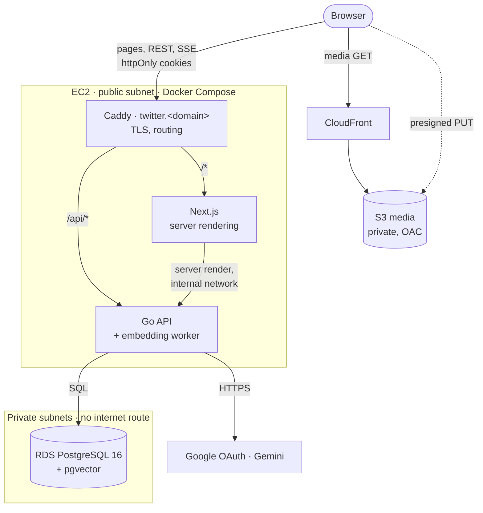
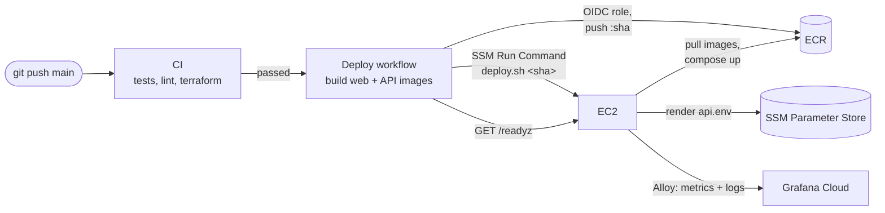

# Twitter Clone

A full-stack Twitter/X clone: a Next.js frontend and a Go API (with an optional Spring Boot API that serves the same contract), PostgreSQL with pgvector, real-time notifications and direct messages, and an AI assistant that answers from recent posts (RAG with Gemini). AWS infrastructure is defined in Terraform, with monitoring through Grafana Cloud.

<p align="center">
  
</p>

## Features

- **Authentication** — Google sign-in; the session lives in httpOnly cookies (short-lived JWT + rotating refresh token), renewed before server rendering
- **Tweets** — Create, delete, like, retweet, and threaded replies
- **Feeds** — "For You" global feed with **time-decay gravity algorithm** (weighing likes, retweets, and replies), following-only feed, and per-user profile feed
- **Follow / Unfollow** — Follow users with follower & following lists
- **Media Uploads** — S3 presigned-URL uploads served via CloudFront CDN
- **Real-time Updates** — one Server-Sent Events (SSE) stream for notifications and direct messages, fanned out across instances via Redis
- **Direct Messages** — one-to-one conversations, delivered in real time over the same SSE stream
- **Search** — Search users, tweets, and hashtags
- **Trending & Discovery** — Trending hashtags and suggested users
- **AI Assistant** — Context-aware chat powered by Gemini 2.5 Flash with personal timeline knowledge
- **RAG (Retrieval-Augmented Generation)** — new tweets are queued in Postgres (same transaction as the tweet) and embedded in the background with Gemini; the assistant retrieves related tweets with pgvector
- **Observability** — Real-time metrics (Prometheus) and log aggregation (Loki) via Grafana Cloud

## Tech Stack

| Layer | Technologies |
|---|---|
| Frontend | Next.js (App Router), TypeScript, Tailwind CSS, TanStack Query, Zustand |
| Backend | Go, Gin, PostgreSQL + sqlc + pgvector, Redis (optional); optional Spring Boot API |
| Infrastructure | AWS (EC2 + Docker Compose + Caddy, RDS, S3, CloudFront, ECR, SSM), Terraform, GitHub Actions |
| Observability | Grafana Cloud (Loki, Prometheus), Grafana Alloy, Node Exporter |

## Architecture

How a request is served:



How code ships:



- **One host, one domain:** Caddy terminates TLS (automatic Let's Encrypt certificates) and routes `/api/*` to the API and everything else to Next.js. The web app and the API share an origin, so there is no CORS and the session cookies are plain first-party cookies.
- **Sessions in httpOnly cookies:** the browser sends them on every request and the Next.js server forwards them when it renders a page; JavaScript never sees a token.
- **Async work without queues:** tweet embeddings are jobs in a Postgres table (`embedding_jobs`), enqueued in the same transaction as the tweet and processed by a worker inside the API (`FOR UPDATE SKIP LOCKED`). No SQS, Lambda or NAT.
- **No public database:** RDS lives in private subnets with no internet route; only the app host's security group can reach it. Backups are kept for 7 days and the instance is protected from deletion.
- **Scaling out later:** one instance keeps rate limits and live updates in memory. To run several instances behind a load balancer, add a shared Redis (ElastiCache) and set `REDIS_URL`; both APIs already support it.

## Observability

We use **Grafana Cloud** for a "Single Pane of Glass" monitoring experience. The EC2 instance runs **Grafana Alloy** alongside **Node Exporter** to provide a unified view of hardware health, Go application performance, and real-time logs.


## Prerequisites

| Tool | Purpose |
|---|---|
| [Go](https://go.dev/dl/) | Backend API development |
| [Node.js](https://nodejs.org/) (v18+) | Frontend development |
| [Docker](https://www.docker.com/) | Local Postgres + Redis, and production deployment |
| [AWS CLI v2](https://docs.aws.amazon.com/cli/latest/userguide/getting-started-install.html) | AWS resource management, Session Manager access |
| [Terraform](https://developer.hashicorp.com/terraform/install) (v1.5+) | Infrastructure provisioning |
| [Make](https://www.gnu.org/software/make/) | Running Go API tasks (migrations, etc.) |
| [Google Cloud Console](https://console.cloud.google.com/) | Google OAuth 2.0 Client ID for authentication |
| [Google AI Studio](https://aistudio.google.com/) | Gemini API Key for Assistant & RAG |

**Install via Homebrew (macOS):**

```bash
brew install go node docker awscli hashicorp/tap/terraform make
```

## Third-Party Setup

### 1. Google OAuth 2.0 Setup

This project uses Google OAuth for authentication. You need to create a Client ID to allow users to sign in.

1.  Go to the [Google Cloud Console](https://console.cloud.google.com/).
2.  **Create a Project**: Click on the project dropdown and select "New Project".
3.  **OAuth Consent Screen**:
    - Go to "APIs & Services" > "OAuth consent screen".
    - Select **External** and click "Create".
    - Fill in the required App Information (App name, support email, developer email).
    - Save and continue until the end.
4.  **Create Credentials**:
    - Go to "APIs & Services" > "Credentials".
    - Click **+ Create Credentials** > **OAuth client ID**.
    - Select **Web application** as the Application type.
    - **Authorized JavaScript origins**:
      - `http://localhost:3000` (Local)
      - `https://twitter.<domain>` (Production)
    - **Authorized redirect URIs**:
      - `http://localhost:3000/api/auth/callback/google`
5.  **Copy Client ID**: Save the **Client ID**. You will need this for your `.env` files and Terraform variables.

### 2. Google Gemini Setup (AI & RAG)

This project uses Google Gemini for the AI Assistant and tweet embeddings.

1.  Go to [Google AI Studio](https://aistudio.google.com/).
2.  Click **Get API key** and create a new API key.
3.  Add the key to your `twitter-go-api/app.env` (`GEMINI_API_KEY`) and `infra/terraform/terraform.tfvars` (`gemini_api_key`).
4.  **Verify Model Availability**: You can check which models are currently available for your key by visiting this URL:
    `https://generativelanguage.googleapis.com/v1beta/models?key=YOUR_API_KEY`
5.  (Optional) Customize the models used via `GEMINI_CHAT_MODEL` and `GEMINI_EMBEDDING_MODEL` (defaults to `gemini-2.5-flash` and `gemini-embedding-2-preview`).

### 3. Grafana Cloud Setup (Monitoring)

This project supports centralized logging and metrics via [Grafana Cloud](https://grafana.com/products/cloud/) (Free Tier).

1.  Sign up for a free account at [Grafana Cloud](https://grafana.com/).
2.  In the Cloud Portal, find the **Prometheus** and **Loki** tiles.
3.  Click **Send Logs** for Loki and **Send Metrics** for Prometheus to find your:
    - **URL**
    - **User ID**
4.  Create an **Access Policy** (or API Token) with `metrics:write` and `logs:write` scopes.
5.  Add these values to your `infra/terraform/terraform.tfvars` to enable automatic monitoring.

## Local Development

### 1. Start infra (Postgres + Redis)

```bash
docker-compose up -d
```

### 2. Run Go API

```bash
cd twitter-go-api
cp app.env.example app.env  # then fill in values
make run                    # migrations run automatically at startup
```

### 3. Run Next.js Web

```bash
cd twitter-next-web
npm install
npm run dev
```

Web: `http://localhost:3000`
API: `http://localhost:8080`

## Contributing

- Enable the pre-commit hook (gofmt, `terraform fmt`, ESLint on staged files): `git config core.hooksPath .githooks`
- Conventions for the Go API, web app and infra are in [`CLAUDE.md`](CLAUDE.md).

## Validation Commands

The same checks CI runs (`.github/workflows/ci.yml`):

```bash
# Go API (integration tests run when TEST_DATABASE_URL points at a disposable Postgres)
cd twitter-go-api && go vet ./... && go test -race ./...

# Web
cd twitter-next-web && npm run lint && npx tsc --noEmit && npm test && npm run build

# Terraform (mocked AWS provider, no credentials)
cd infra/terraform && terraform fmt -check -recursive .. && terraform init -backend=false && terraform validate && terraform test
```

## AWS Infrastructure

| Service | Purpose |
|---|---|
| **EC2** (t3.small + Elastic IP) | Docker Compose stack: Caddy (TLS + routing), Next.js, Go API, Grafana Alloy, Node Exporter |
| **RDS** | PostgreSQL 16 + pgvector, encrypted, private subnets, 7-day backups, deletion protection |
| **S3 + CloudFront** | Media: presigned uploads to a private bucket, served through CloudFront (OAC) |
| **ECR** | Web and API images, tagged by commit SHA (immutable) |
| **SSM** | Parameter Store for runtime config and secrets; Session Manager for shell access and DB tunnels (no SSH port) |
| **IAM OIDC** | GitHub Actions deploys with short-lived credentials (no stored AWS keys) |
| **Route 53** (optional) | DNS for `twitter.<domain>`; any DNS provider works |

Roughly $35–45/month: EC2 t3.small, RDS db.t4g.micro and the public IPv4 address make up nearly all of it.

Terraform lives in [`infra/terraform`](infra/terraform) (one file per concern: `network.tf`, `ec2.tf`, `rds.tf`, `storage.tf`, `ssm.tf`, `ecr.tf`, `github.tf`, `dns.tf`) and the files that run on the host in [`infra/ec2`](infra/ec2).

## AWS Setup

> You need an [AWS account](https://aws.amazon.com/free/) and a domain you control.

### 1. AWS CLI credentials

Use an admin identity for Terraform, preferably IAM Identity Center:

```bash
aws configure sso   # or: aws configure (IAM user access key)
```

For shell access to the instance, also install the [Session Manager plugin](https://docs.aws.amazon.com/systems-manager/latest/userguide/session-manager-working-with-install-plugin.html) (`brew install --cask session-manager-plugin`).

### 2. State bucket (once per account)

```bash
cd infra/bootstrap
terraform init && terraform apply
terraform output state_bucket
```

### 3. Provision infrastructure

```bash
cd infra/terraform
cp backend.hcl.example backend.hcl            # set bucket = <state_bucket>
cp terraform.tfvars.example terraform.tfvars  # fill in your values
terraform init -backend-config=backend.hcl
terraform plan
terraform apply                               # ~10 min (RDS is the slow part)
```

### 4. DNS

Without `route53_zone_id`, add the record from `terraform output dns_records` at your DNS provider: an `A` record for `twitter.<domain>` → the Elastic IP. Caddy obtains the certificate as soon as it resolves.

### 5. GitHub Actions variables

In **Settings → Secrets and variables → Actions → Variables**, add:

| Variable | Value |
|---|---|
| `AWS_REGION` | e.g. `ap-southeast-1` |
| `AWS_DEPLOY_ROLE_ARN` | `terraform output github_deploy_role_arn` |
| `ECR_API_REPOSITORY` | `terraform output ecr_api_repository` |
| `ECR_WEB_REPOSITORY` | `terraform output ecr_web_repository` |
| `EC2_INSTANCE_ID` | `terraform output ec2_instance_id` |
| `SITE_DOMAIN` | e.g. `twitter.chanombude.me` |
| `GOOGLE_CLIENT_ID` | your OAuth client ID (compiled into the web app) |

None of these are secrets. Then run the **Deploy** workflow once (Actions → Run workflow) to ship the first images.

### Tear down

RDS has deletion protection. Set `deletion_protection = false` in `rds.tf`, `terraform apply`, then:

```bash
cd infra/terraform && terraform destroy   # keeps a final DB snapshot; stops all other charges
```

Terraform checks run in CI without AWS credentials: `terraform fmt -check`, `validate`, and `terraform test` (plans the whole stack against a mocked AWS provider, see [`tests/`](infra/terraform/tests)).

## Deployment

[`deploy.yml`](.github/workflows/deploy.yml) runs when CI passes on `main`:

1. **Build & push** the web and API images to ECR, both tagged with the commit SHA
2. **Deploy**: SSM Run Command executes [`/opt/twitter/deploy.sh <sha>`](infra/ec2/deploy.sh) on the instance, which renders `api.env` from SSM Parameter Store, pulls both images and runs `docker compose up -d`
3. **Verify**: polls `https://twitter.<domain>/readyz` and the home page

**Roll back:** Actions → Deploy → Run workflow with `image_tag` set to an earlier commit SHA (skips the build).

**Change a setting:** edit `terraform.tfvars`, `terraform apply` (updates SSM), then re-run the deploy (or `sudo /opt/twitter/deploy.sh <sha>` on the host) so the containers pick it up.

## AWS Access

### Shell on the instance

Through **Session Manager** (no SSH port, no key pairs):

```bash
aws ssm start-session --target $(terraform output -raw ec2_instance_id)
```

Or in the console: **EC2 → Instances → Connect → Session Manager**.

On the host:

```bash
cd /opt/twitter
sudo docker compose ps
sudo docker compose logs -f api web caddy
sudo tail -f /var/log/cloud-init-output.log   # first-boot setup progress (~2-3 min)
```

### Connect to RDS

RDS has no public access. Forward a local port through the instance:

```bash
aws ssm start-session \
    --target $(terraform output -raw ec2_instance_id) \
    --document-name AWS-StartPortForwardingSessionToRemoteHost \
    --parameters "host=$(terraform output -raw rds_endpoint | cut -d: -f1),portNumber=5432,localPortNumber=5433"
```

Then connect your DB tool to `127.0.0.1:5433`, database `twitter_db`, with the credentials from `terraform.tfvars` (port `5433` avoids clashing with a local Postgres).

## Project Structure

```
├── twitter-next-web/    # Next.js frontend
├── twitter-go-api/      # Go backend (primary)
├── twitter-java-api/    # Optional Spring Boot backend: same API and schema as the Go one
├── infra/
│   ├── bootstrap/       # One-time: S3 bucket for Terraform state
│   ├── terraform/       # AWS infrastructure (+ tests/ with a mocked-provider plan)
│   └── ec2/             # What runs on the host: compose.yml, Caddyfile, Alloy config, deploy.sh
├── docs/                # Modernization plan, review notes, diagrams
├── .github/workflows/   # CI (tests, lint, Terraform checks) and deploy pipelines
└── docker-compose.yml   # Local development (Postgres + pgvector, Redis)
```
